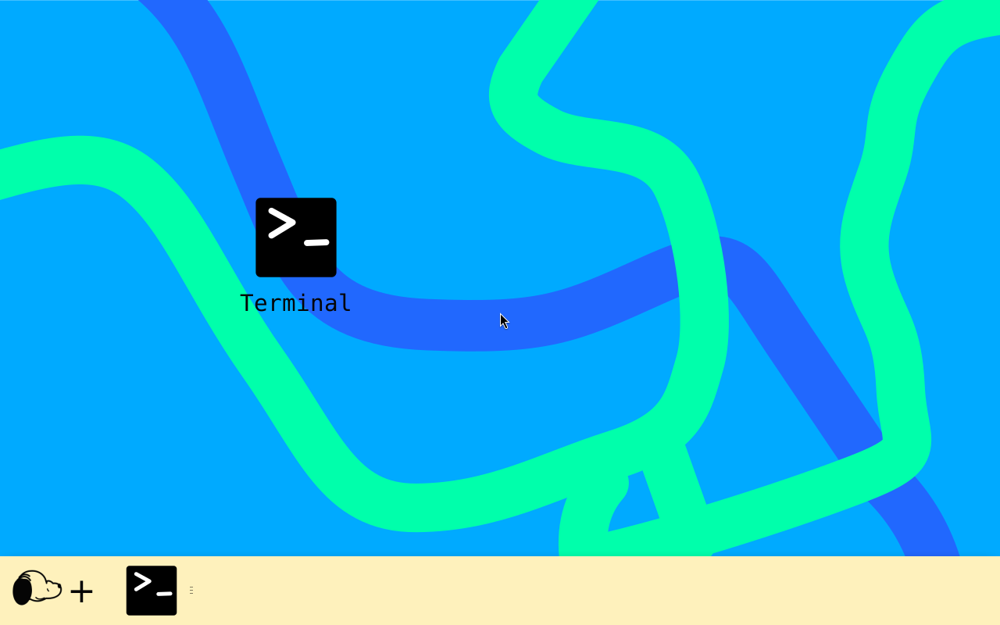

# 🐾 SnoopyOS

Sistema Linux live de 64 bits com base Debian 13.7, Xfce e área de trabalho personalizada

## 🎮 SnoopyOS Games 0.2 Preview

A edição Games inclui widgets GTK leves para CPU, RAM e espaço livre, além de modo FPS reversível e limpeza segura de miniaturas/temporários antigos ao iniciar jogos pelo lançador Games

**FPS 1000 é uma meta, não uma garantia:** a taxa real depende da GPU, do jogo e dos drivers
A primeira ISO Games foi publicada em 31/10/2026, após os testes de construção, SHA-256 e boot UEFI/QEMU do workflow. A instalação completa em disco ainda não foi validada

[**Baixar SnoopyOS-0.2-Games-amd64.iso**](https://github.com/Chimpi-hackintosh/SnoopyOS-Image/releases/download/v0.2-games.1/SnoopyOS-0.2-Games-amd64.iso) · [SHA-256](https://github.com/Chimpi-hackintosh/SnoopyOS-Image/releases/download/v0.2-games.1/SHA256SUMS.txt) · [Notas da prévia Games](https://github.com/Chimpi-hackintosh/SnoopyOS-Image/releases/tag/v0.2-games.1)

Alterações posteriores no código só entram na ISO depois de uma nova construção

[Código e instruções da edição Games](snoopyos/games/README.md) · [Workflow manual para gerar ISO Games](.github/workflows/publish-games.yml)

## Baixar a edição Lite

[**Baixar SnoopyOS-0.1-Lite-amd64.iso**](https://github.com/Chimpi-hackintosh/SnoopyOS-Image/releases/download/v0.1-lite.3/SnoopyOS-0.1-Lite-amd64.iso)

Tamanho: **1,954 GiB** — **2.097.676.288 bytes**, abaixo de 2 GiB

[SHA-256](https://github.com/Chimpi-hackintosh/SnoopyOS-Image/releases/download/v0.1-lite.3/SHA256SUMS.txt) · [Notas e arquivos da versão](https://github.com/Chimpi-hackintosh/SnoopyOS-Image/releases/tag/v0.1-lite.3)

Baixe a ISO como um único arquivo e use-a como unidade óptica de uma máquina virtual de 64 bits
A configuração de teste usa 3 GiB de RAM
O usuário live é `snoopy` e a senha é `live`

Montar o arquivo no Windows abre os arquivos da imagem
Para iniciar o SnoopyOS, dê boot pela ISO na máquina virtual
O modo live não preserva alterações após desligar

## Área de trabalho

Papel de parede azul com curvas verdes e azuis, barra creme, menu Snoopy + e atalhos do Terminal

- `Ctrl + Alt + T` abre o Terminal
- `Super` abre o menu
- Mantém Thunar, Firefox ESR em português, áudio, rede e Calamares

## Como a imagem ficou menor

Foram removidos LibreOffice, ajuda e traduções extras, fontes Noto adicionais/CJK, métodos de entrada IBus e parte dos firmwares
As traduções da interface mantêm português e inglês
Os firmwares básicos Atheros, Intel Wi-Fi e Realtek permanecem
Alguns computadores físicos podem precisar de firmware adicional para gráficos, áudio ou rede

O instalador Calamares e os pacotes locais necessários ao GRUB permanecem
O Debian Installer alternativo e os arquivos de instalação associados foram retirados

## Verificação

A construção verifica o SHA-256 da base, a consistência dos pacotes, as dependências, o catálogo BIOS/UEFI e o limite de tamanho
O boot UEFI, a personalização do Xfce e o atalho do Terminal foram verificados em QEMU
A instalação completa em disco ainda não foi testada

## Construir a ISO

A receita está em [snoopyos/lite](snoopyos/lite) e as instruções completas estão no [README da edição Lite](snoopyos/lite/README-Lite.md)

O [workflow do GitHub Actions](.github/workflows/publish-lite.yml) só publica a imagem depois dos testes de tamanho e boot
Os dados exatos de cada imagem e o commit da receita acompanham a Release

Esta versão é uma prévia de desenvolvimento
As ferramentas deste repositório seguem a [licença do projeto](LICENSE)
Os pacotes Debian conservam suas próprias licenças

## Aviso de suporte

Aviso traduzido, data de 04/11/2026, versões e limites de distribuição em [SUPPORT.md](SUPPORT.md)
